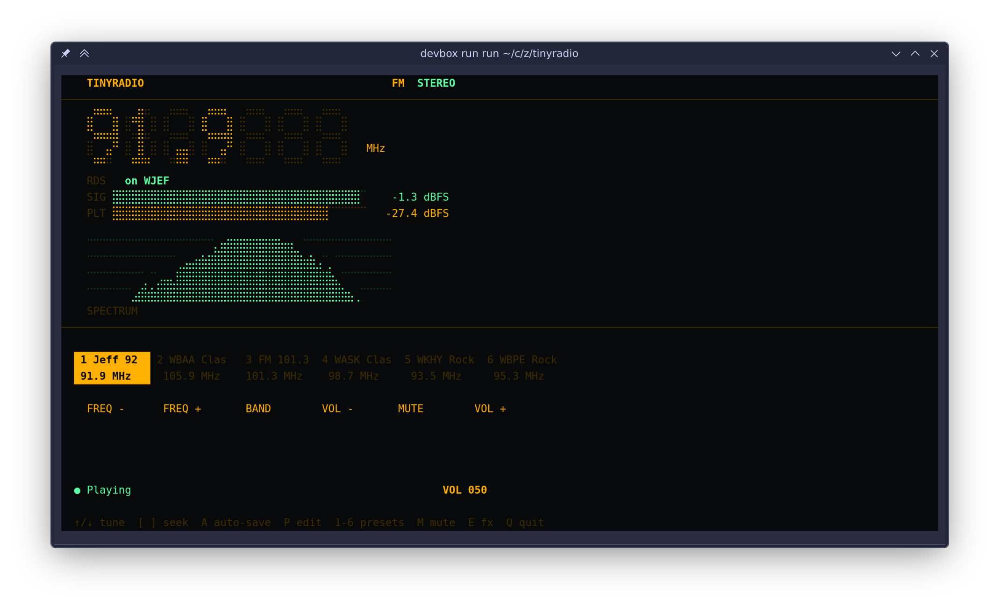

# TinyRadio

A simple software-defined radio (SDR) receiver with a terminal UI, built in Zig.

## What it does

TinyRadio turns your RTL-SDR dongle into an AM/FM radio with a text-based interface. It's not pretty, it's not optimal, its probably not even acturate, but it makes music come out of the air.



## Requirements

These are included in the devbox shell

- [Zig](https://ziglang.org/download/) 0.17.1 (pinned in `devbox.json`)
- RTL-SDR dongle and drivers (`librtlsdr`)
- PulseAudio or PipeWire with its PulseAudio interface (Linux). The app must run in a session where `XDG_RUNTIME_DIR` is set, so it can reach your audio server.

### Running TinyRadio

## With Devbox

Install [Devbox](https://www.jetify.com/devbox) and run:

```bash
devbox run run
```

## With Zig

```bash
zig build -Doptimize=ReleaseFast run
```

### Running tests

```bash
devbox run test
```

The tests don't need the dongle. The hardware-dependent radio test is commented out in `src/radio.zig`.

### Benchmark

```bash
zig build bench -Doptimize=ReleaseFast
```

This runs the tuner and the FM stereo demodulator on a synthetic 5-second signal at 1.2 MS/s, with no dongle needed. It times the zigradio tuner and our tuner in `src/tuner.zig`, and prints the median over five runs for each.

### Tracy zones

The code has [Tracy](https://github.com/wolfpld/tracy) zones through [ztracy](https://github.com/zig-gamedev/ztracy). They compile to no-ops unless you enable them:

```bash
zig build bench -Doptimize=ReleaseFast -Denable_ztracy=true
```

Then open the Tracy GUI and connect to the running process. ztracy is vendored under `vendor/ztracy`, with one build-script line changed to work on Zig 0.17. Upstream ztracy still calls `std.meta.fields`, which 0.17 removed.

### Profiling

`perf.sh` builds a ReleaseFast binary and records it with `perf`. It needs `sudo` for `perf`'s call graphs. The app itself runs as your user, because PulseAudio rejects root clients. Press **Q** to stop the app, and the report opens when perf finishes. Run it from a terminal, not with output redirected to a file, so `sudo` can prompt for your password.

```bash
./perf.sh
```

If the app exits with an error, `perf.sh` skips the report and removes the profile.

## Controls

- **↑/↓** - Tune frequency
- **B** - Switch AM/FM bands  
- **M** - Mute/unmute
- **-/+** or **←/→** - Volume down/up
- **1-6** - Load presets
- **Q** or **Ctrl+C** - Quit

## Dependencies

This project is powered by the excellent [zigradio](https://github.com/vsergeev/zigradio) library by vsergeev, which does all the heavy SDR lifting. Massive credit to that project for making software-defined radio flow graphs in Zig!

## License

[MIT License](LICENSE) - see the code, hack it, break it, fix it, share it.

## Note

This is a quick-and-dirty radio app. If you're new to Zig, this might be a fun project to explore, but don't expect production quality. It's more of a "look, SDR works in Zig!" proof of concept.
